# numpy-neural-networks

Redes neuronales hechas con NumPy.

## Proyectos

### Aceptacion

[Ver código](Aceptacion.py)

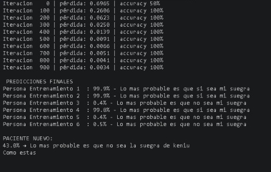

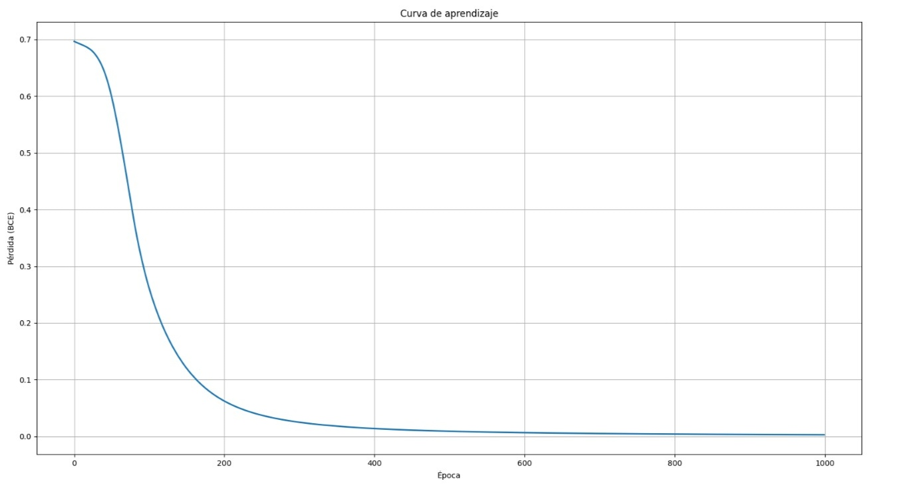

### Despido

[Ver código](Despido.py)

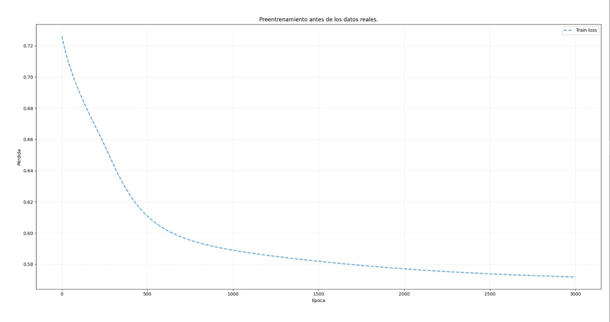

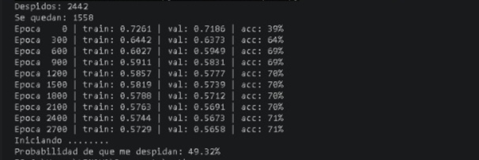

### Gosteo

[Ver código](Gosteo.py)

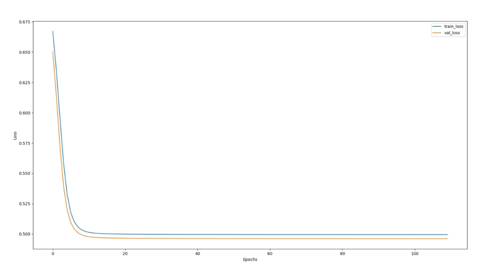

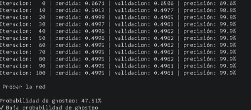

### Mejor opcion

[Ver código](Mejor_opcion.py)

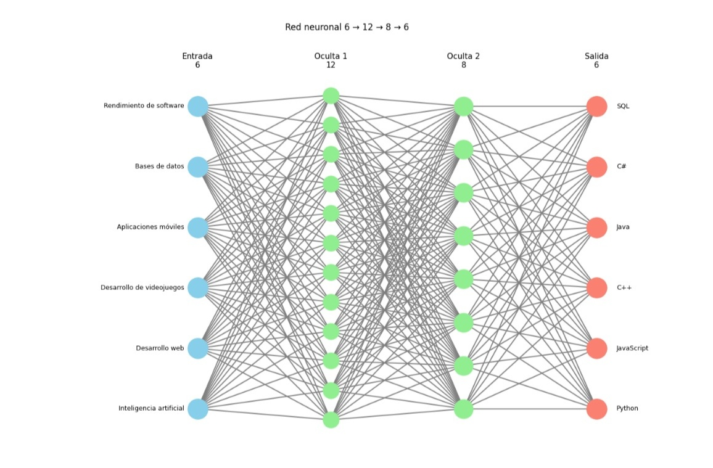

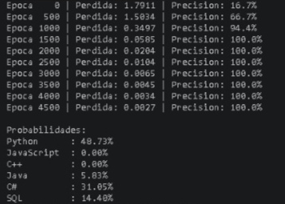

### mintiendo

[Ver código](mintiendo.py)

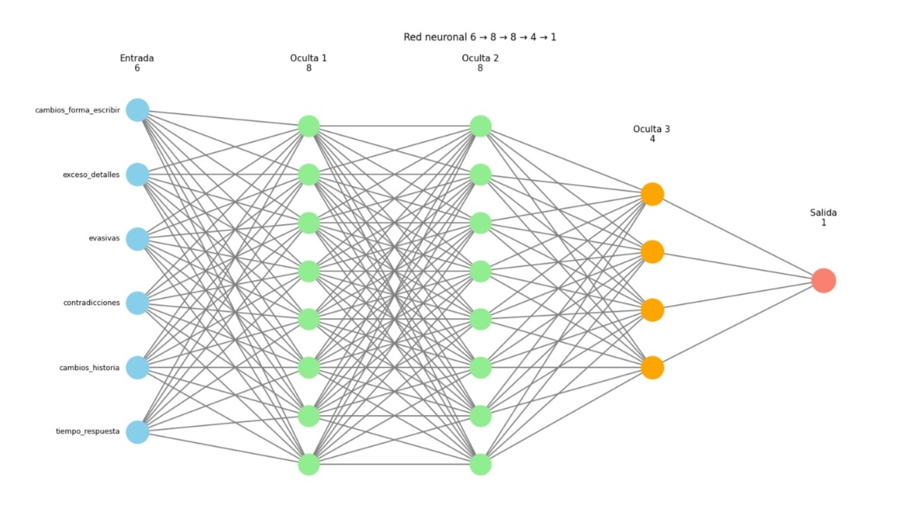

### probabilidad de robo

[Ver código](probabilidad_de_robo.py)

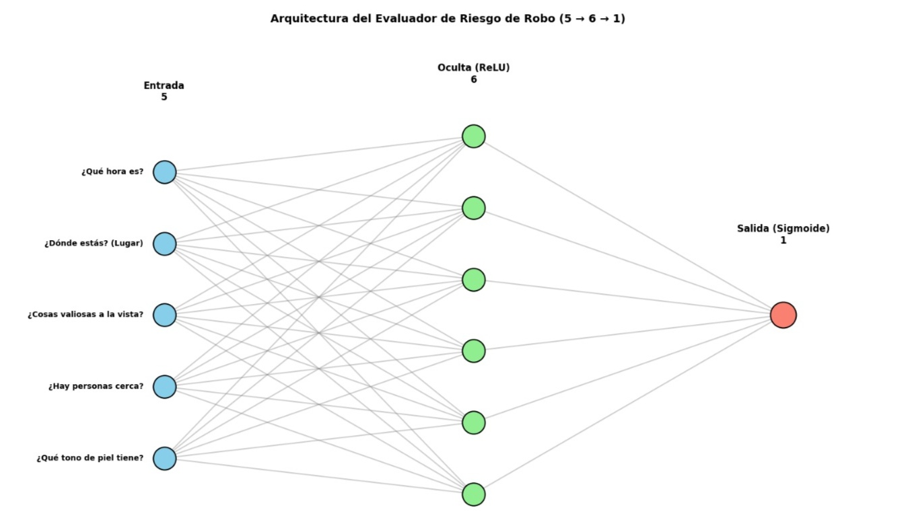

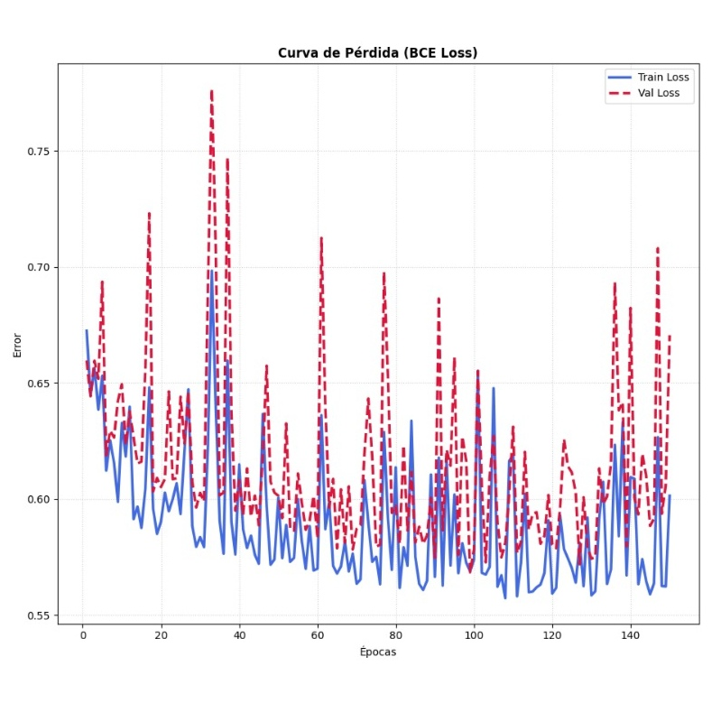

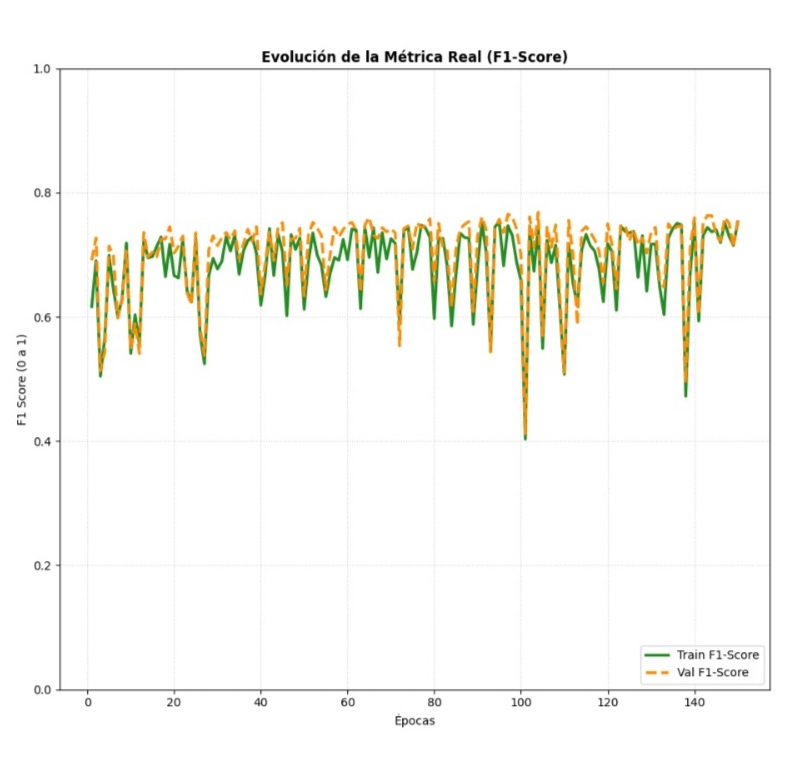

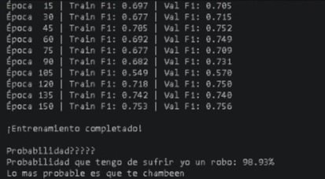
